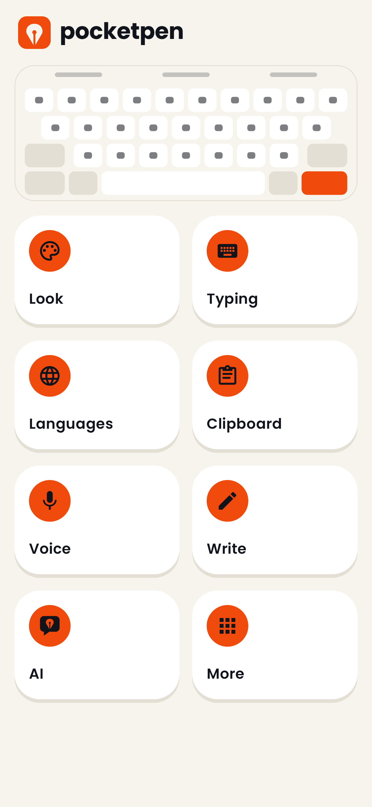
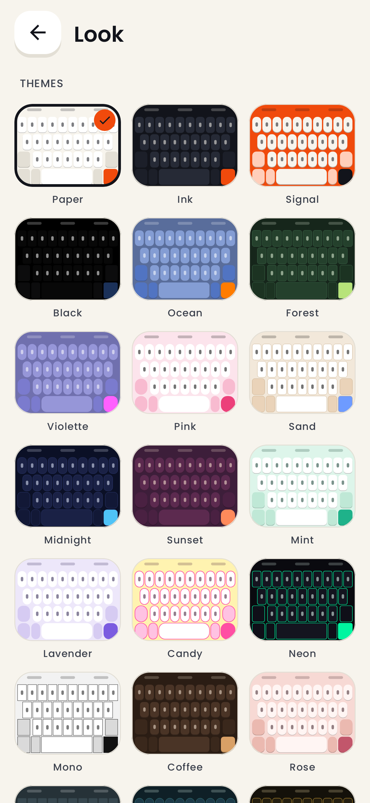
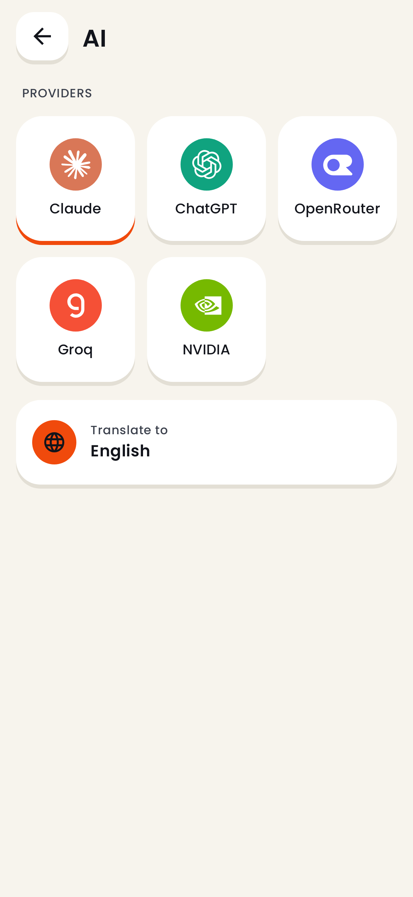

<h1 align="center">Pocketpen</h1>

<p align="center">
  <b>An open-source Android keyboard with a clipboard that remembers, built-in AI writing tools, voice typing and handwriting.</b>
</p>

<p align="center">
  <a href="../../releases/latest"></a>
  
  <a href="LICENSE"></a>
  
</p>

<p align="center">
  
  
  
  
</p>

---

## Contents

- [Overview](#overview)
- [Features](#features)
- [Installation](#installation)
- [Privacy and security](#privacy-and-security)
- [Building from source](#building-from-source)
- [Project structure](#project-structure)
- [Contributing](#contributing)
- [Roadmap](#roadmap)
- [License and acknowledgements](#license-and-acknowledgements)

## Overview

Pocketpen is a privacy-respecting keyboard for Android. It is a fork of [HeliBoard](https://github.com/Helium314/HeliBoard), which in turn builds on the Android Open Source Project keyboard. It keeps that mature typing engine (suggestions, autocorrect, dictionaries, many languages and layouts) and adds the tools a daily keyboard should have, with a settings experience designed to be understood at a glance.

**Design principles**

- **Simple.** Every setting is a title, a one-line explanation and a switch or a visual choice.
- **Private.** No analytics, no telemetry. Network access happens only when you use a feature that needs it.
- **Yours.** Bring your own AI provider and key. Your data stays on your device unless you ask otherwise.

## Features

### Clipboard that remembers

- History persists across restarts. Keep items for 1 hour, 1 day, 7 days, 30 days, 90 days or forever.
- Screenshots appear instantly as a suggestion above the keyboard and in the clipboard.
- Tabs for All, Recent, Pinned and Images. Text is laid out in two columns, images in a grid.
- Long-press an item to pin, paste or delete it. Swipe to delete.
- A new-line key next to the space bar makes pasting several items on separate lines easy.
- Content that apps mark as sensitive, such as passwords and one-time codes, is never stored.

<p align="center"></p>

### Toolbar and tools panel

- The strip above the keyboard shows your toolbar when you are idle and word suggestions while you type, then switches back on its own.
- Tap the grid icon to open a tools panel: text editing, one-handed mode, floating keyboard, resize, theme, AI model, handwriting and more, all without leaving the keyboard.
- Customize in place: tap the pencil, then hold and drag tools onto the toolbar, reorder them, or pin your mic button. A snap line shows exactly where a tool will land.

### AI writing assistant

- Select text and tap the AI key to fix grammar, rewrite, shorten, expand, change tone, summarize, translate, reply, or tell the AI exactly what to do.
- Copy, insert or replace with the result in one tap.
- Supports **Claude, ChatGPT, OpenRouter, Groq and NVIDIA**. Choose a model, set a default, switch at any time.
- Nothing is sent until you tap an action. The assistant is disabled in password fields.

<p align="center"></p>

### Voice typing

- Tap the mic and the status appears in the toolbar: "Speak now", "Listening". There is no pop-up.
- Use your phone's built-in recognizer, or **Whisper by Groq** for higher accuracy. When you are offline it falls back to the built-in recognizer automatically.

### Handwriting

- Turn the keyboard into a canvas and write with a finger or a stylus. Palm rejection is included, and recognition runs on the device. The canvas can be resized.

### Appearance

- 21 themes with distinct key shapes, plus control over key height, text size, spacing, border thickness, color and roundness.
- More than 30 bundled fonts for the key labels.
- **Writing styles** that turn what you type into Unicode styled letters (bold, script, fraktur, circled and more) so the style is preserved when the message is sent.
- Built-in click sounds, or use your own sound file.
- Open the floating keyboard button in settings to try changes on the real keyboard immediately.

<p align="center">
  
  
  
</p>

### Typing

- Word suggestions, autocorrect, next-word prediction and a personal dictionary that learns from you. Incognito mode stops learning on demand.
- Everything inherited from HeliBoard: many languages and layouts, number row, one-handed mode, emoji and more.

## Installation

1. Download the APK from the [latest release](../../releases/latest).
2. Open it on your phone and allow installation from your browser or file manager if asked.
3. Open Pocketpen. The setup guides you through enabling and selecting the keyboard.

Requires Android 6.0 (API 23) or newer. The application id is `com.pocketpen.keyboard`.

Pre-release builds from the latest commit are published as the `latest` pre-release.

## Privacy and security

- No analytics and no telemetry.
- The network is used only for the AI assistant, Groq voice typing and the one-time download of the handwriting model, and only when you use those features.
- AI keys are encrypted with the Android Keystore and excluded from backups.
- Voice recordings are deleted from the device right after transcription.
- Password fields are protected: AI, voice and writing styles are disabled in them.

Please report security issues privately through GitHub's security advisories for this repository.

## Building from source

Requirements: JDK 21 and the Android SDK (the Gradle wrapper handles the rest).

```bash
./gradlew assembleDebug
./gradlew assembleRelease
```

Outputs are written to `app/build/outputs/apk/`. Continuous integration builds every push, and tagged releases are built by the `Release` workflow. See [docs/BUILDING.md](docs/BUILDING.md) for details.

## Project structure

| Path | Contents |
| --- | --- |
| `app/src/main/java/helium314/keyboard/` | Keyboard engine and Pocketpen features (the `helium314` package name is kept to make upstream merges easy) |
| `.../ai/` | AI providers, prompts and the assistant panel |
| `.../voice/` | Voice typing and the Groq Whisper client |
| `.../clipboardplus/`, `.../keyboard/clipboard/` | Clipboard storage, screenshot capture and views |
| `.../toolspanel/` | Tools panel and toolbar editor |
| `.../settings/` | Compose settings app |
| `tools/logo-anim/` | Remotion project that renders the intro animation |
| `docs/` | Specification and build notes |

## Contributing

Issues and pull requests are welcome. Please read [CONTRIBUTING.md](CONTRIBUTING.md) first. Keep changes focused, match the style of the surrounding code and describe how you tested them.

## Roadmap

- Wider device testing and stabilization of the beta.
- Smarter next-word prediction.
- More tools in the tools panel (GIF and sticker search are deliberately out of scope for now).
- Release signing with a private key.

See [docs/MASTER_SPEC.md](docs/MASTER_SPEC.md) for scope and decisions.

## License and acknowledgements

Pocketpen is licensed under the [GNU General Public License v3.0](LICENSE).

It is built on [HeliBoard](https://github.com/Helium314/HeliBoard) and the Android Open Source Project keyboard, and uses ML Kit Digital Ink Recognition for handwriting. Bundled fonts are licensed under the SIL Open Font License, except Roboto Slab (Apache 2.0). Provider logos belong to their respective owners.
