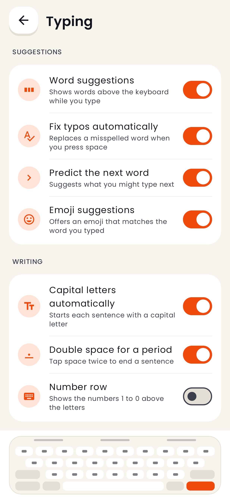
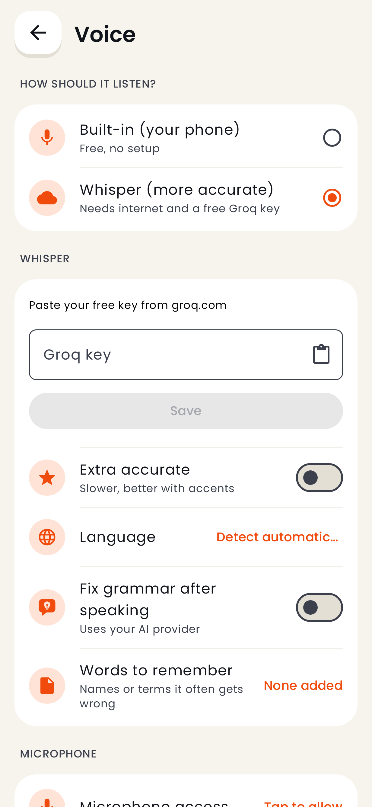
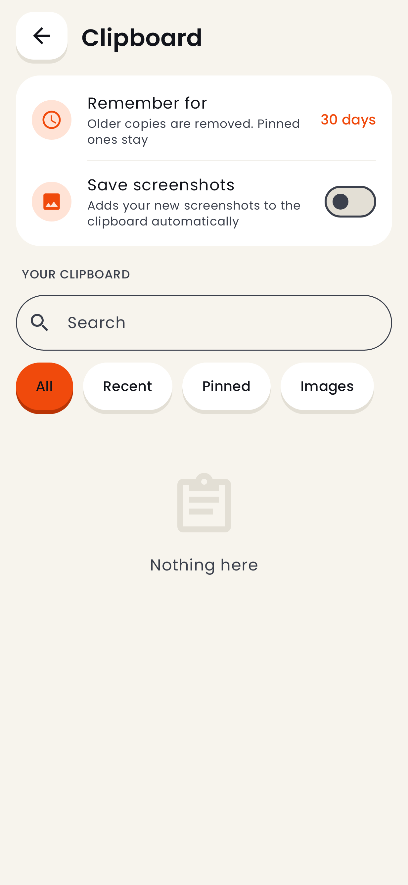
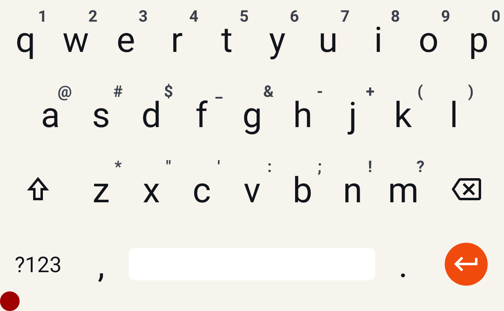
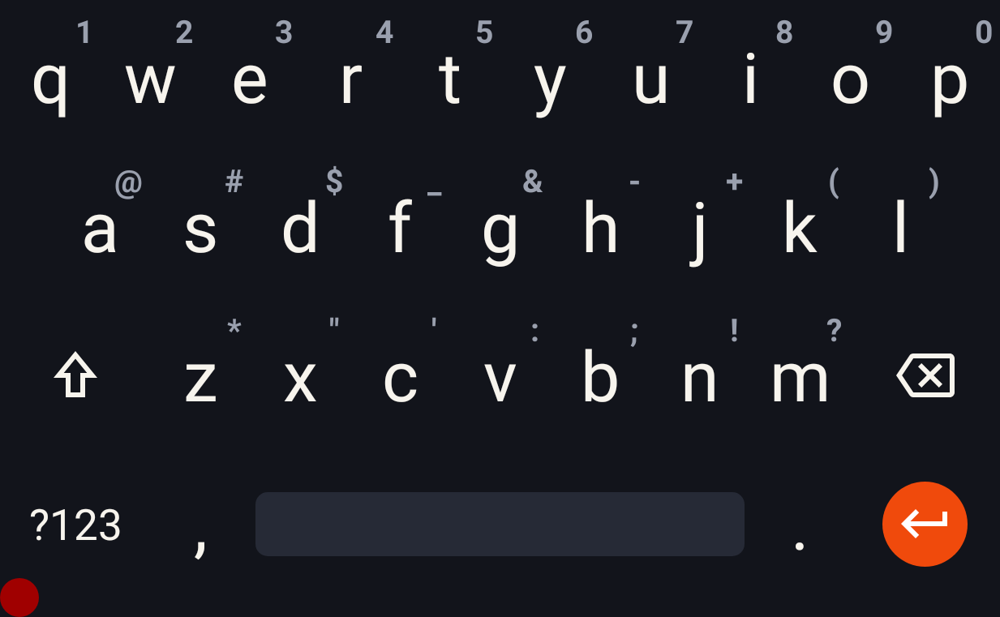
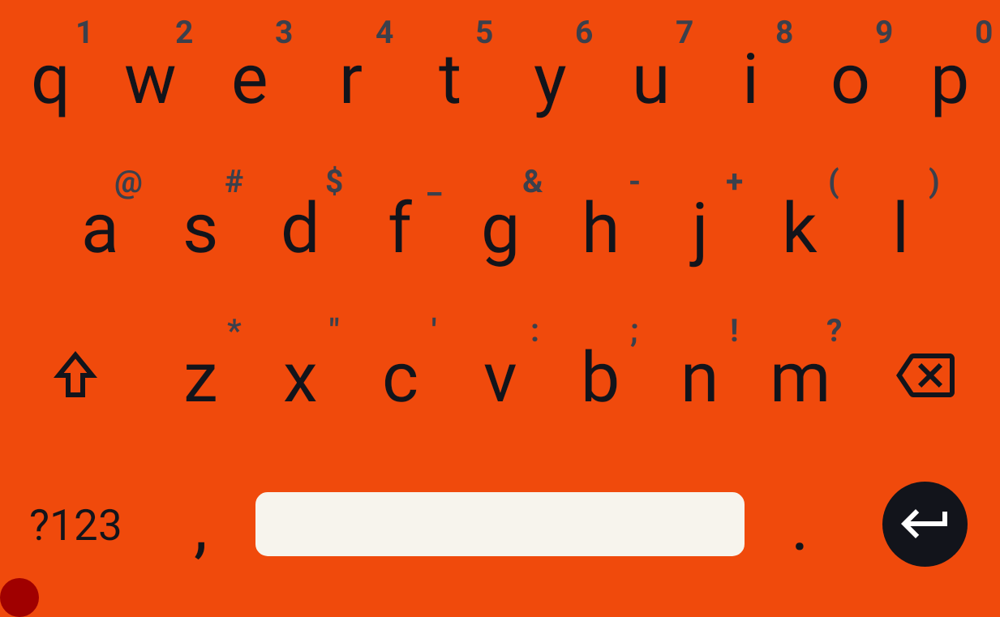
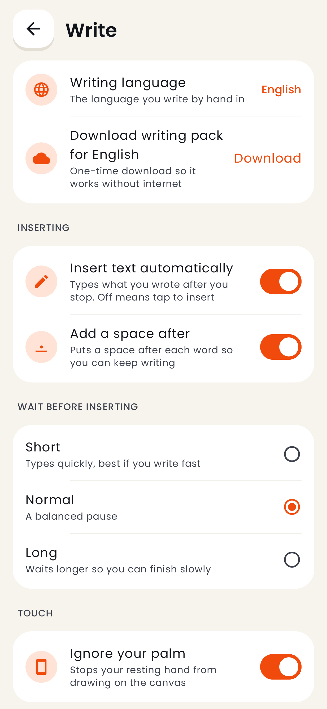
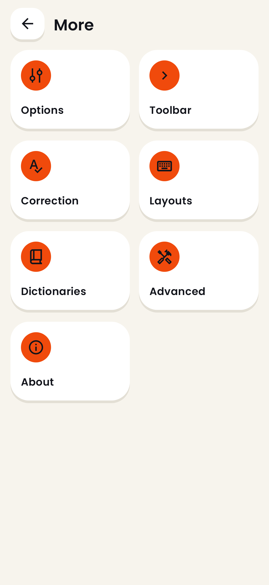

<h1 align="center">Pocketpen</h1>

<b>A fast, private Android keyboard with a clipboard that remembers, AI writing tools, voice typing and handwriting.</b>

  
  
  

  
  
  
  

Pocketpen is built on [HeliBoard](https://github.com/Helium314/HeliBoard), a proven open source typing engine, and adds what a daily keyboard should have: a clipboard you can trust, AI help when you want it, and settings you can understand at a glance.

## Highlights

### Clipboard that remembers
- History survives restarts. Keep it for 1 hour, 1 day, 7 days, 30 days, 90 days or forever.
- **Screenshots appear instantly** as a suggestion above the keyboard and in the clipboard, like the best stock keyboards.
- Recent items first, pinned items below, images in a tidy grid. Long-press for Pin, Paste or Delete. Swipe either way to delete.
- A new-line key next to space makes pasting several items on separate lines easy.
- Anything an app marks as sensitive, such as passwords and one-time codes, is never stored.

### Gboard-style toolbar and tools panel
- Tap the grid icon for a panel of tools: one-handed mode, text editing, floating keyboard, handwriting and more.
- Tap the pencil to customize: hold and drag tools onto the toolbar, reorder them, or pin your mic button. No trip to Settings.

### AI writing assistant
- Select text, tap the AI key, and fix grammar, rewrite, shorten, expand, change tone, summarize, translate, reply, or tell the AI exactly what to do.
- Copy, insert or replace with the result in one tap.
- Bring your own key for **Claude, ChatGPT, OpenRouter, Groq or NVIDIA**. Pick a model, make one the default, switch any time.
- Nothing is sent until you tap an action, and the panel is blocked in password fields.

### Voice typing
- Tap the mic and the status appears right in the toolbar: "Speak now", "Listening", with no pop-up.
- Choose your phone's built-in recognizer or **Whisper by Groq** for higher accuracy. Offline? It switches to the built-in one automatically.

### Handwriting
- Turn the keyboard into a canvas and write with a finger or stylus. Palm rejection included. Recognition runs on the phone.

### Look the way you like
- **21 distinct themes**, plus control over key height, text size, spacing, border thickness, color and roundness.
- **Writing fonts**: pick the style of your key letters.
- A live keyboard preview stays on screen while you change settings, so you always see what you are doing.
- Choose from built-in key sounds or use your own audio file.

  
  
  

### Simple settings
Every setting is a title, a short explanation and a switch. No walls of text, no jargon. Technical options are tucked into collapsed sections.

  
  

### Everything HeliBoard already does
Suggestions and autocorrect, dictionaries, custom layouts, number row, one-handed mode, emoji, multiple languages.

## Install

Grab the latest APK from the [Releases](../../releases) page and install it. Debug builds are signed with a fixed key, so a newer build installs over the older one.

Enable Pocketpen under **Settings → System → Keyboard**, then follow the three-step setup when you open the app.

## Privacy

No analytics and no telemetry. The network is used only when you use the AI assistant, Groq voice typing, or the one-time handwriting model download. API keys are encrypted with the Android Keystore and kept out of backups.

## Status

Beta. Each build is compiled and checked by GitHub Actions; features are still being tested on real devices. Feedback is welcome through issues.

## Build

Builds run on GitHub Actions. Every push to `main` publishes a test APK. See [docs/BUILDING.md](docs/BUILDING.md) and [docs/MASTER_SPEC.md](docs/MASTER_SPEC.md).

## License and credits

GPL-3.0. Pocketpen is a fork of [HeliBoard](https://github.com/Helium314/HeliBoard), which builds on the Android Open Source Project keyboard. Bundled fonts are under the SIL Open Font License (Roboto Slab under Apache 2.0). Provider logos belong to their owners.
